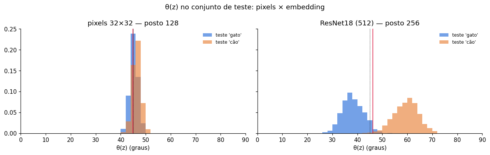
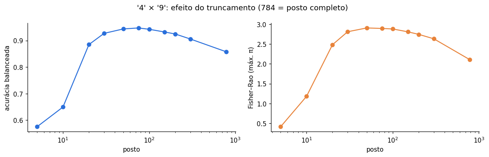
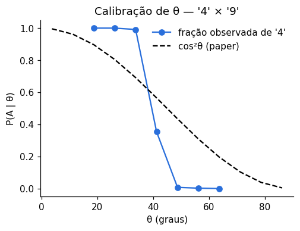

# Ângulo de alinhamento da GSVD: de pixels a embeddings de CNN

Implementação em Python do método de
**[Sobrinho et al., 2026, *GSVD for Geometry-Grounded Dataset Comparison: An Alignment Angle Is All You Need*](https://arxiv.org/abs/2603.10283)**
e um experimento que leva o método além dos pixels usados no paper.

O método compara dois conjuntos de dados e diz, para cada amostra, se ela se parece mais com o conjunto A, com
o B ou com os dois. Participei da iniciação científica no IC/UFRJ em que a GSVD foi estudada e que deu
origem ao paper. Este repositório é um trabalho meu, posterior: a implementação, os testes e o experimento
com embeddings de uma rede neural.

## Resultados em resumo

| Pergunta | Resposta |
|---|---|
| A implementação está certa? | O Teorema 1 do paper confere numericamente (erro de 4e-15) e os resultados do MNIST se reproduzem no padrão. |
| O método funciona em embeddings de uma CNN? | **Sim.** Cães × gatos: 0,62 de acurácia em pixels, 0,98 no embedding da ResNet18, contra 0,99 de uma regressão logística treinada sobre o mesmo embedding (*linear probe*). |

## A ideia do método

Dados A ∈ ℝ^{d×p} e B ∈ ℝ^{d×q} (amostras nas colunas), a GSVD dá um referencial comum H:

```
A = H · diag(c) · U,     B = H · diag(s) · V,     c² + s² = 1
```

Cada coluna de H é uma direção; c diz quanto A usa essa direção e s quanto B usa. Para uma amostra z, o ângulo
de alinhamento compara o custo de reconstruí-la com A e com B:

```
θ(z) = arctan( ‖c⁻¹ ⊙ H⁺z‖ / ‖s⁻¹ ⊙ H⁺z‖ )  ∈ [0°, 90°]
```

θ ≈ 0° significa "parece A", θ ≈ 90° "parece B" e θ ≈ 45° ambíguo.

Uma leitura que ajuda: como AAᵀ = H C² Hᵀ e BBᵀ = H S² Hᵀ, cada c² é a fração da energia conjunta que vem de A
naquela direção, e tan θ(z) é a razão entre a distância de Mahalanobis de z a A e a B.

## Experimento: pixels × embeddings de CNN

O paper testa o método em pixels do MNIST e deixa embeddings como trabalho futuro. Aqui: reprodução no MNIST
e extensão para cães × gatos (Oxford-IIIT Pet), comparando pixels com o embedding de uma ResNet18 congelada.



| Representação | Modelo | Acurácia balanceada (teste) | Fisher–Rao (máx. 3,14) |
|---|---|---|---|
| Pixels 32×32 | θ, limiar 45° | 0,616 | 0,608 |
| ResNet18 (512) | θ, limiar 45° | 0,971 | 2,971 |
| ResNet18 (512) | θ, limiar calibrado | 0,981 | 2,971 |
| ResNet18 (512) | regressão logística | 0,988 | — |

O que encontrei:

- **Em pixels não há geometria linear para comparar:** todas as imagens ficam perto de 45°. No embedding, gatos
  concentram em ~37° e cães em ~60°.
- **θ chega perto de um classificador linear treinado (regressão logística) sem usar gradiente** (0,981 × 0,988). Não é mais barato: os dois ajustam em
  menos de um segundo sobre embeddings já extraídos. O que θ acrescenta é o diagnóstico: um grau por amostra, a
  lista das imagens ambíguas e as direções extremas.
- **O posto é o hiperparâmetro que mais pesa em pixels.** Com posto completo θ satura em 0° e 90°. No par 4×9 do
  MNIST, truncar para posto 50 leva a acurácia de 0,857 para 0,943. O paper deixa essa sensibilidade como
  trabalho futuro.
- **cos²θ não é uma probabilidade calibrada.** O paper interpreta P(A|θ) = cos²θ; no 4×9 a fração real de "4"
  cai de ~0,99 para ~0,01 entre 34° e 49°, quase um degrau.
- **45° não é o melhor limiar** em cães × gatos: o calibrado ficou entre 46° e 54°.
- **Multiclasse:** 45 GSVDs um-contra-um chegam a 93,15% no MNIST.

| Truncamento do posto (4×9) | Calibração de cos²θ (4×9) |
|---|---|
|  |  |

Notebook executado: [`notebooks/`](notebooks/gsvd-angle-cnn-embeddings-executado.ipynb)
· [no Kaggle](https://www.kaggle.com/code/hmarquesb/gsvd-angle-on-cnn-embeddings)

## Limitações

- Uma seed, sem intervalos de confiança.
- A ResNet18 foi treinada no ImageNet, que já contém cães e gatos.
- θ é linear e binário.

## Estrutura

| | |
|---|---|
| `gsvd_angle.py` | biblioteca (só numpy): GSVD via decomposição CS, θ(z), direções extremas, Fisher–Rao, classificadores |
| `tests/` | 10 testes: Teorema 1, blocos, casos do notebook Julia da IC, direções extremas, Fisher–Rao, classificadores |
| `notebooks/` | notebook executado, notebook limpo para o Kaggle e o script que o gera |
| `figures/` | figuras usadas neste README |

## Como rodar

```bash
pip install -r requirements.txt
pytest -q        # não baixa nada
```

O notebook `gsvd-angle-kaggle.ipynb` roda sozinho no Kaggle com *Internet: On*, GPU T4 e a competição
*Digit Recognizer* como input.

## Créditos

- **Método:** A. Sobrinho, E. Marques, J. Paixão, D. S. Menasché, H. Mirandola (IC/IM, UFRJ),
  [arXiv:2603.10283](https://arxiv.org/abs/2603.10283).
- A GSVD em blocos foi adaptada da implementação de referência em Julia do grupo de iniciação científica.
- A parte de CNN e transfer learning (ResNet18 congelada + camada linear de classificação) vem do módulo 5 da pós em Engenharia
  de IA da Coders, em que implementei uma CNN do zero.
- Dados: MNIST / Kaggle Digit Recognizer; Oxford-IIIT Pet (Parkhi et al., 2012).
